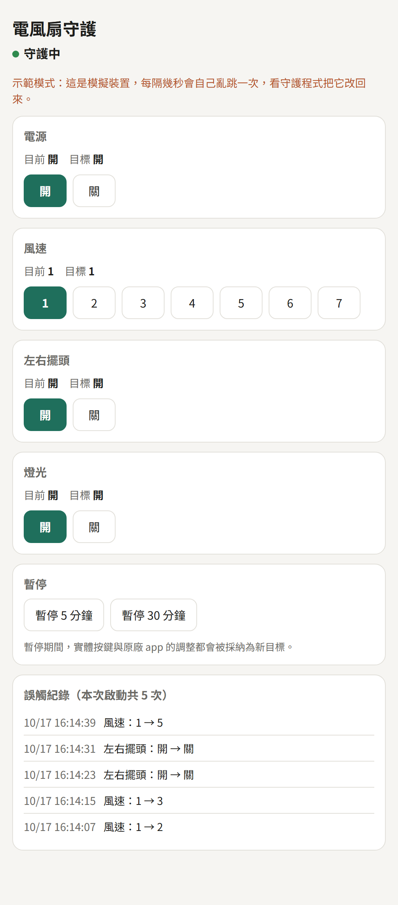

# tuya-ghost-touch-guard

**繁體中文** | [English](README.en.md)

[](https://github.com/kevinyin9/tuya-ghost-touch-guard/actions/workflows/ci.yml)

電風扇半夜自己開機、電暖器自己改溫度、檯燈自己亮起來？如果它是 Tuya 模組的智慧家電，這支程式可以在區域網路裡即時發現「觸控面板誤觸」，並在一秒內把它改回你要的狀態。

不用拆機、不用改裝，只要一台在同一個 Wi-Fi 裡、一直開著的電腦或樹莓派。



## 為什麼需要它

很多平價智慧家電用的是電容式觸控面板，受潮、灰塵或電源雜訊會讓它「自己按」：關著的電風扇突然開機、風速亂跳、燈自己亮。換面板很麻煩，原廠 app 也沒有「鎖定狀態」的功能。

這支程式換個方式處理：既然誤觸擋不住，那就在誤觸發生的瞬間把它改回來。

## 運作方式

Tuya 裝置在區域網路裡會主動回報每一次狀態變化。程式和裝置保持一條長連線，一收到「電源變成開」這類回報，就跟你設定的目標狀態比對；不一樣就立刻送指令改回去。

目標狀態只能從程式提供的手機控制頁修改。如果你想用原廠 app 或實體按鍵調整，先在控制頁按「暫停」，暫停期間的所有調整都會被當成新的目標。

為了避免設定寫錯時程式和裝置互相拉扯，同一個功能兩次改回之間至少隔 0.5 秒，一分鐘內改回超過 30 次就自動停手，並在紀錄裡說明可能原因。

## 先試試看（不需要任何裝置）

需要 Python 3.10 以上。

```bash
pip install -r requirements.txt
python tuya_guard.py demo
```

用瀏覽器開 <http://localhost:8765/>。示範模式會用一台模擬的電風扇，每隔 8 秒自己亂跳一次，你可以看到守護程式把它改回來，並記在「誤觸紀錄」裡。

## 接上真實裝置

**1. 取得裝置編號（device id）和本地金鑰（local key）**

本地金鑰是程式在區網裡控制裝置用的密碼。用 [tinytuya 的設定精靈](https://github.com/jasonacox/tinytuya#setup-wizard---getting-local-keys) 取得：在 Tuya 開發者平台建立雲端專案、連結你的 app 帳號，再執行 `python -m tinytuya wizard`。

台灣的帳號在建立專案時，資料中心要選 **Western America**。另外注意：**裝置重新配對後本地金鑰會改變**，需要重跑一次精靈。

**2. 建立設定檔**

```bash
cp config.example.json config.json
```

填入 `device_id` 和 `local_key`。`ip` 保持 `"Auto"` 即可，程式會在區網廣播找到裝置。`config.json` 已列在 `.gitignore` 裡，不會被上傳。

**3. 找出每個按鍵對應的功能編號（DP）**

```bash
python tuya_guard.py monitor
```

逐一按裝置上的按鍵，畫面會印出哪個 DP 變成什麼值。把要守護的 DP 寫進設定檔的 `dps`。**值的型別要跟畫面上印的一樣**，例如風速印出 `3` 就寫整數 `3`，不要寫字串 `"3"`。

**4. 開始守護**

```bash
python tuya_guard.py guard
```

用手機開 `http://<這台電腦的 IP>:8765/` 就是控制頁。

## 設定檔欄位

| 欄位 | 說明 |
|---|---|
| `device_id`、`local_key` | 裝置編號與本地金鑰，見上一節 |
| `ip` | 裝置 IP；填 `"Auto"` 會自動尋找 |
| `version` | Tuya 協定版本，`ip` 為 `"Auto"` 時會自動判斷 |
| `title` | 控制頁標題 |
| `language` | 控制頁語言：`zh-TW` 或 `en` |
| `http_host`、`http_port` | 控制頁監聽的位址與埠號 |
| `http_password` | 控制頁密碼；留空代表不需要密碼 |
| `min_revert_interval` | 同一個 DP 兩次改回之間的最短秒數 |
| `max_reverts_per_minute` | 一分鐘內最多送出幾次改回指令 |
| `dps` | 要守護的 DP：`name` 顯示名稱、`options` 可選的值、`labels` 每個值的顯示文字（可省略） |

## 控制頁的安全

建議設定 `http_password`。設了之後瀏覽器會跳出帳號密碼視窗，帳號隨便填，密碼填你設定的值。

控制頁也會拒絕從其他網站發出的指令，避免你瀏覽某個惡意網頁時，它偷偷叫你的瀏覽器去操作家裡的裝置。

**不要把控制頁的埠直接開放到網際網路上。** 想在外面用手機操作，請用 Tailscale、WireGuard 這類 VPN 連回家裡的網路。

## 讓它一直開著

守護程式要一直執行才有用。電腦睡眠或關機時就不會守護。

- **樹莓派或 Linux**：用 systemd 開機自動啟動。

  ```ini
  # /etc/systemd/system/tuya-guard.service
  [Unit]
  Description=Tuya ghost-touch guard
  After=network-online.target
  Wants=network-online.target

  [Service]
  WorkingDirectory=/home/pi/tuya-ghost-touch-guard
  ExecStart=/usr/bin/python3 tuya_guard.py guard
  Restart=always

  [Install]
  WantedBy=multi-user.target
  ```

  接著執行 `sudo systemctl enable --now tuya-guard`。

- **Windows**：用「工作排程器」建立工作，觸發條件選「登入時」，動作的程式填 `python`、引數填 `tuya_guard.py guard`、起始位置填專案資料夾。
- **macOS**：在終端機執行 `caffeinate -i python3 tuya_guard.py guard`，避免電腦閒置時進入睡眠。

## 程式架構

全部程式都在 `tuya_guard.py` 一個檔案裡，只依賴 [tinytuya](https://github.com/jasonacox/tinytuya)。由三個部分組成：

1. **連線迴圈**（`run_guard`、`run_session`）：連上裝置、接收狀態回報、送出改回指令、定時送心跳維持連線；斷線就每 5 秒重試。
2. **守護狀態**（`Guard`）：記住目標狀態、判斷哪些回報是誤觸、決定要送哪些指令，並負責節流和暫停。目標狀態存在 `guard_state.json`，重啟後沿用。
3. **控制頁**（`start_http`、`render_page`）：用 Python 內建的 HTTP 伺服器提供手機頁面與 `/api/state` JSON 介面。

連線迴圈和裝置之間只透過幾個方法溝通，所以示範模式能用 `FakeDevice` 這個模擬裝置直接替換真的裝置，測試也是這樣寫的。

## 常見問題

**`monitor` 出現 `WinError 10048` 或「位址已在使用中」**

守護程式正在執行。兩者都要占用 UDP 6666、6667 埠來尋找裝置，同一台電腦一次只能跑一個。

**改回的指令一直送，紀錄說「一分鐘內已送出 30 次」**

通常是設定檔 `options` 裡值的型別和裝置回報的不一樣，例如寫成字串 `"3"`，但裝置回報的是整數 `3`。用 `monitor` 確認後修正。

**原廠 app 還能用嗎？**

可以，但沒有暫停時，用 app 調整也會被當成誤觸改回來。要改設定請從控制頁改，或先按暫停。

## 實測裝置

- 威技 WPF02 系列 DC 電風扇（Tuya Wi-Fi 模組，原廠 app 為 H smart-HW）

其他 Tuya 裝置只要能用 tinytuya 控制，原理上都適用。歡迎開 issue 分享你的裝置與 DP 對照。

## 開發

```bash
pip install -r requirements-dev.txt
python -m ruff check .
python -m pytest
```

每次推送都會在 GitHub Actions 上，以 Windows、macOS、Linux 搭配 Python 3.10 與 3.13 跑一次檢查和測試。

## 作者

Kevin Yin。我接 Python 自動化、智慧家電整合和資料處理的客製案件。如果你有類似「設備不聽話、流程想自動化」的問題想解決，歡迎聯絡：<kevinyin999@gmail.com>

## 授權

[MIT](LICENSE)
